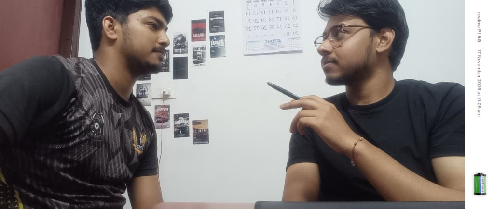
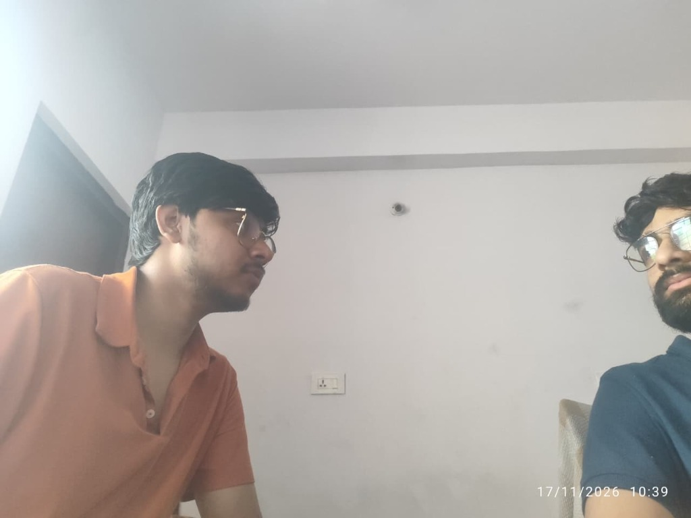

# OrderMate – Fieldwork Notes

## 1. Place and Observation Session
- **Location:** Hostel K (Block E & Block F), Main Hostel Security Gate & Residential Wing Corridors, NIT Jamshedpur
- **Date & Time:** 16 November 2026, 23:00 to 17 November 2026, 01:00 (Observation window: 23:10 – 00:50; Follow-up morning verification: 17 November 2026, 10:30 – 11:15)
- **Context:** Peak late-night quick-commerce delivery hours when students order study fuel, coffee, milk, noodles, and emergency supplies, followed by morning follow-up discussions on checkout costs.

## 2. Timestamped Fieldwork Photos

### Photo 1: In-Person Interview Session

- **Description:** On-site fieldwork discussion and survey session with student regarding late-night grocery orders, platform surcharges, and cart-stuffing habits.
- **Hardware Timestamp Watermark:** *17 November 2026 at 11:05 am* (captured via realme P1 5G on-site).

### Photo 2: Fieldwork Data Collection & Problem Verification

- **Description:** Interview discussion regarding delivery fees, small-cart penalties, and how students coordinate purchases in Hostel K.
- **Hardware Timestamp Watermark:** *17/11/2026 10:39* (captured on-site in Hostel K).

---

## 3. Real-Person Interview
- **Person Name:** Aman Singh (Student, MCA 3rd Year, Resident of Hostel K, Block E, Room E601)
- **Role:** Regular late-night quick-commerce user (Flipkart Minutes & Blinkit)
- **3 Things Aman Said:**
  1. *"I only wanted to make some late-night coffee while studying, so I just needed a small 50g Nescafe and 500ml milk (about ₹73). But the platform was slapping on ₹65 in combined delivery, small-cart penalty, handling, and night surge fees—almost doubling the cost."*
  2. *"Paying ₹65 in pure fees felt like a scam, so I fell into the trap of adding a large 100g coffee jar and extra milk sachets to cross the ₹199 free-delivery tier. I ended up spending ₹181 extra on inventory I didn't need that night."*
  3. *"There are students in rooms right next to me in Block E (like E603 and E605) and down in Block F who are placing orders within the exact same 15 minutes. If we had an easy way to combine our carts, none of us would be wasting money."*
- **1 Thing That Surprised Me:**
  - Over half the students surveyed (13 out of 25) chose to spend **₹135 to ₹240 extra** on impulse snacks, oversized coffee jars, and surplus beverages rather than paying a ₹50 delivery surcharge. Across 25 students in one hostel alone, this led to **₹2,834 in avoidable financial loss in a single night**.

## 4. How the Data Was Collected
- Surveyed 25 students across Hostel K (Block E rooms E601–E615 and Block F rooms F001–F016) right after they placed or received their orders between 11:10 PM and 12:50 AM.
- Recorded platform used, actual items needed, base cart value, coping strategy (`PAID_CHARGES` vs `ADDED_UNNECESSARY_ITEMS`), itemized fees, extra spending on unneeded items, and calculated the net avoidable loss.
- Raw records are structured in `data/data.csv`.
